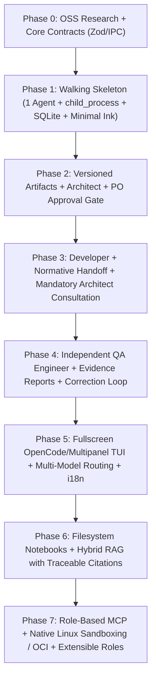

# Phased Implementation Plan — Product Owner CLI (PO CLI)

## 1. Architectural Implementation Strategy

To avoid the classic pitfall of multi-agent systems (attempting to build the IPC bus, all 3 roles, the Notebook RAG engine, Linux sandboxing, and the full Ink TUI simultaneously), this plan follows an incremental **Walking Skeleton** approach:

1. **Foundations and contracts first:** Lock down Core schemas and the Linux inter-process protocol before scaling functional complexity.
2. **Early validation of the authority model:** Progressively introduce the three core roles (`Architect`, `Developer`, `QA`) operating on persistent, versioned artifacts.
3. **Strict decoupling:** Keep the Core/Orchestrator, Agent Runtime, Persistence layer (SQLite + Filesystem), and TUI presentation layer (Ink) strictly separated.
4. **Scale to knowledge and isolation:** Layer in the Notebook/RAG engine, MCP integration, multi-language settings, and native Linux sandboxing on top of a proven multi-agent core.

---

## Phase 0: Technical Research, Foundational ADRs, and Core Contracts

Before coupling the system to external dependencies, evaluate reference open-source projects and define the domain schemas governing the entire architecture.

* **Objective:** Decide what to reuse or adapt from reference projects (*Pi, OpenCode, Slipwright, CAO, Open Orchestra, TinySDLC*) and establish TypeScript + Zod contracts for the entire system.
* **Technical Scope:**
  1. **Targeted Benchmarking & Comparative Matrix:**
     * Analyze the *Agent Loop*, session management, and extensibility of **Pi** and **OpenCode**.
     * Analyze SDLC role models, approval gates, and artifact flows in **Slipwright**, **Open Orchestra**, and **TinySDLC**.
     * Analyze CLI process orchestration in **CAO (CLI Agent Orchestrator)**.
  2. **Layered Package Structure:**
     * `src/core`: Domain contracts, authority rules, workflow state machine, and i18n dictionary.
     * `src/storage`: Decoupled SQLite persistence and filesystem artifact management.
     * `src/runtime`: Agent execution, *Agent Loop*, LLM gateway, tool system, RAG, and MCP.
     * `src/tui`: Terminal presentation layer built with **Ink**.
  3. **Zod Contracts:**
     * IPC message schemas (`JSON-RPC 2.0` over `stdio`).
     * Internal event bus schemas (token streaming, tool calls, state transitions, approval requests).
     * Project, Session, Artifact, Consultation, QA Report, and Notebook schemas.
* **Definition of Done:** Comparative matrix and foundational ADRs documented; TypeScript modules and Zod schemas compiling with zero coupling to UI or specific LLM vendors.

---

## Phase 1: "Walking Skeleton" — Minimal Runtime, Agent Process, and Base Persistence

Build the simplest vertical pipeline to validate the Linux multi-process architecture and local SQLite persistence.

* **Objective:** Have the Orchestrator process spawn a child Agent Worker process on Linux, communicate via `JSON-RPC 2.0` over `stdio`, execute an *Agent Loop* turn, and persist state in SQLite.
* **Technical Scope:**
  1. **Local Persistence (SQLite):** Initial schema for `Projects`, `Sessions`, `Messages`, and `Settings`. Project workspace directory management.
  2. **Execution Abstraction (`LinuxAgentProcessRunner`):** Implementation of Modality 1 (local OS process via `child_process` on Linux with lifecycle management and `SIGTERM`/`SIGINT` handling).
  3. **Agent Loop + Initial LLM Gateway:** Iterative cycle `LLM → Decision → Tool Call → Execution → Result → Final Reply` with token streaming and a common provider interface.
  4. **Initial CLI/TUI in Ink:** View capable of creating/opening a project, sending messages to the worker process, rendering live streaming, and restoring history on restart.
* **Definition of Done:** Users can launch `pocli`, create a project, converse with an agent running in a separate Linux PID, close the app, and resume with all state intact.

---

## Phase 2: Artifact System and the Software Architect Role (Workflow Phases 1 to 3)

Introduce PO CLI's core paradigm: project knowledge crystallizes into **persistent, versioned artifacts** under the final authority of the human Product Owner.

* **Objective:** Implement the **Software Architect** *Agent Harness* and the formal cycle of analysis, proposal, review, and architecture approval.
* **Technical Scope:**
  1. **Filesystem + SQLite Artifact Manager:**
     * Structured disk layout for Functional/Non-Functional Requirements, User Stories, Architecture, ADRs, and Technical Specifications.
     * Versioning, `SHA-256` integrity hashes, status tracking (`DRAFT`, `PENDING_APPROVAL`, `APPROVED`, `REJECTED`, `SUPERSEDED`), and approval audit logs in SQLite.
  2. **Software Architect Harness:**
     * Role instructions, Product Owner interaction policies, and specialized tools (`propose_requirement`, `write_architecture_doc`, `record_adr`, `request_po_approval`).
  3. **Approval Gate in TUI:**
     * Interface in Ink allowing the Product Owner to review Architect proposals, request revisions, or formally approve the architecture.
* **Definition of Done:** The user converses with the Architect, the Architect generates requirement and architecture artifacts, and the user formally approves them in the TUI, locking the approved architecture version as the project baseline.

---

## Phase 3: The Senior Developer, Normative Handoff, and Authority Consultations (Workflow Phases 4 and 5)

Introduce the second virtual team member and enforce technical authority boundaries between agents.

* **Objective:** Ensure the **Senior Developer** implements software from approved artifacts and mandatory consults the Architect whenever encountering ambiguities, blockers, or architectural deviations.
* **Technical Scope:**
  1. **Normative Handoff Mechanism:** Formal packaging of approved artifacts (requirements, approved architecture, ADRs, specifications) as the Developer's normative context, rather than relying on a chat summary.
  2. **Senior Developer Harness & Tooling:**
     * Source file creation/editing, command execution, and protocol tools (`consult_architect`, `submit_for_qa`).
  3. **`Developer ↔ Architect` Consultation Flow:**
     * Controlled, logged routing within the project context.
     * Architect evaluation: direct technical resolution if within existing architecture boundaries, or escalation to the human Product Owner (`ESCALATED_TO_PO`) if approved decisions are impacted.
  4. **Role Artifact Permissions:** Developer has read-only access to architectural artifacts and write access to implementation plans, source code, and assigned technical docs.
* **Definition of Done:** Starting from an approved architecture, the Developer plans and writes code; when encountering an architectural conflict, unilateral modification is blocked, a formal consultation is routed to the Architect (and escalated to the PO if needed), the resolution is logged, and the deliverable is prepared for QA.

---

## Phase 4: The Independent QA Engineer and Validation/Correction Loop (Workflow Phases 6, 7, and 8)

Complete the initial three-member virtual engineering team with independent quality assurance and close the full 8-phase engineering workflow.

* **Objective:** Incorporate the **Independent QA Engineer** with authority to independently verify deliverables, execute real tests, collect evidence, reject defective builds, and coordinate the correction loop with the Developer.
* **Technical Scope:**
  1. **Complete 8-Phase Workflow State Machine:**
     * Formal transitions across Project Creation → Architect Analysis → Architecture Approval → Developer Handoff → Implementation → QA Validation → Correction Cycle → Final PO Acceptance.
  2. **Independent QA Engineer Harness:**
     * Independent evaluation criteria decoupled from the Developer's internal session.
     * Tools to run verification tests, capture execution outputs as evidence, classify defects by severity (`LOW`, `MEDIUM`, `HIGH`, `CRITICAL`), and emit `QA_Report` artifacts with an `ACCEPT` or `REJECT` verdict.
  3. **Correction Loop (`QA ↔ Developer ↔ Architect`):**
     * If QA rejects the delivery, defects are returned to the Developer and the project enters `PHASE_7_CORRECTION_CYCLE`.
     * The Developer fixes the defects (consulting the Architect if fixes impact architecture) and resubmits to QA until `ACCEPT` is achieved.
* **Definition of Done:** End-to-end execution of all 8 workflow phases on a real project, including QA detecting a defect with evidence, rejecting the delivery, Developer fixing the defect, QA re-validating, and final acceptance by the Product Owner.

---

## Phase 5: Fullscreen OpenCode/Multipanel TUI, Multi-Language Settings, and Multi-Model Routing

Expand the terminal user experience into a fullscreen command center with OpenCode-inspired ergonomics and per-role LLM routing.

* **Objective:** Provide a clean fullscreen startup interface with `/` slash commands, `Ctrl+Tab` multipanel switching, dynamic English/Spanish (`en`/`es`) interface language settings, and independent LLM model configurations per role.
* **Technical Scope:**
  1. **Fullscreen Ink TUI (Clean View + Multipanel Command Center):**
     * Alternate screen buffer (`\x1b[?1049h`) and full terminal viewport sizing (`stdout.columns` × `stdout.rows`).
     * Default OpenCode-style centered ASCII banner and prompt input box with interactive `/` slash command popover (`/architect`, `/developer`, `/qa`, `/propose`, `/approve`, `/handoff`, `/implement`, `/consult`, `/validate`, `/accept`, `/notebooks`, `/settings`, `/view`, `/exit`).
     * `Ctrl+Tab` toggle between the clean view and the Multipanel Command Center (Team, Versioned Artifacts, Linked RAG Notebooks, and Direct Communication Channel).
     * Interactive `/settings` modal and command (`/settings lang en|es`) persisted in SQLite.
  2. **Decoupled Multi-Model Gateway:**
     * Per-role model assignment based on reasoning capability, cost, and latency without coupling model choice to the workflow definition.
* **Definition of Done:** The Product Owner can direct the entire project from the fullscreen TUI, execute `/` slash commands, switch between clean and multipanel views with `Ctrl+Tab`, switch the UI between English and Spanish via `/settings`, and run each role on its configured model.

---

## Phase 6: Knowledge Notebooks and Integrated Hybrid RAG System

Incorporate user-managed specialized knowledge bases backed by filesystem directories.

* **Objective:** Allow users to create and manage thematic **Notebooks** (global or project-linked) on the filesystem and expose them to agents via a hybrid RAG engine with full source traceability.
* **Technical Scope:**
  1. **Functional Notebook Management:**
     * Creation, naming, description, activation/deactivation, and binding of notebooks to Linux filesystem directories.
     * Support for arbitrary subdirectory structures, local documents (Markdown, TXT, JSON, YAML, code), and external reference links.
     * Flexible N:M association between Notebooks and Projects.
  2. **Incremental Indexing Pipeline:**
     * File change detection on Linux (`fs.watch`/inotify) and incremental indexing based on `SHA-256` content hashes.
     * Structure-aware chunking preserving metadata (origin notebook, document path, section heading, line range, external URL).
  3. **Hybrid Retrieval RAG Engine:**
     * Combined lexical search (`SQLite FTS5 BM25`) and semantic vector cosine similarity with hybrid reranking.
  4. **Role Access Control & Traceable Citations:**
     * Per-role authorization policies for each Notebook.
     * Explicit source citations in agent responses and artifacts: `[Notebook: X | Doc: Y | Section: Z (L1-L...)]`.
* **Definition of Done:** Users create and link filesystem Notebooks to a project; modifying a file triggers incremental re-indexing, and agents retrieve and accurately cite authorized Notebook sources in their decisions and deliverables.

---

## Phase 7: MCP Integration, Native Linux Sandboxing, and Team Extensibility

Consolidate the Linux platform capabilities: external tool integration via MCP, OS-level security isolation, and dynamic team expansion.

* **Objective:** Integrate the MCP protocol per role, implement native Linux sandboxing modalities, consolidate the 4-layer memory system, and enable custom specialist roles.
* **Technical Scope:**
  1. **Model Context Protocol (MCP) Integration:**
     * Tool discovery, MCP server registration over `JSON-RPC 2.0` `stdio`, and granular role-based permission enforcement.
  2. **Native Linux Isolation & Security (Execution Modalities 2 and 3):**
     * **Modality 2 (`LINUX_BWRAP`):** Sandboxing via Bubblewrap (*Linux namespaces*), mounting `/` read-only, isolating PID/IPC namespaces, and bind-mounting only the project workspace as writable.
     * **Modality 3 (`OCI_CONTAINER`):** Support for running agent workers or QA environments inside Podman/OCI containers under the same Orchestrator contract.
  3. **4-Layer Memory & Role Extensibility:**
     * Consolidation of the four memory layers: `CONVERSATIONAL`, `WORKING`, `PROJECT_PERSISTENT`, and `AGENT_SPECIFIC`.
     * Dynamic registration of new specialist Harnesses (e.g., `security_auditor`, `devops_engineer`) integrated into the project workflow.
* **Definition of Done:** Complete PO CLI platform running on Linux with support for sandboxed processes, role-filtered MCP servers, 4-layer persistent memory, and demonstrated registration of a fourth virtual team specialist verified by automated integration tests.
