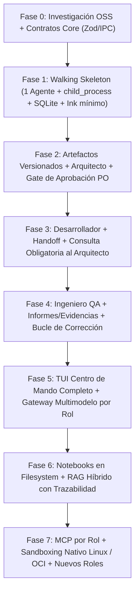

# Plan de Implementación por Fases — Product Owner CLI (PO CLI)

## 1. Estrategia Arquitectónica de Implementación

Para evitar el riesgo clásico de los sistemas multiagente (intentar construir simultáneamente el bus IPC, los 3 roles, el motor RAG de Notebooks, el sandboxing de Linux y la interfaz completa en Ink), este plan sigue un enfoque de **Walking Skeleton (Esqueleto Funcional Incremental)**:

1. **Cimientos y contratos primero:** Fijar los contratos del Core y el protocolo de procesos en Linux antes de escalar en complejidad funcional.
2. **Validación temprana del modelo de autoridad:** Introducir progresivamente los tres roles (`Arquitecto`, `Desarrollador`, `QA`) operando sobre artefactos persistentes y versionados.
3. **Desacoplamiento estricto:** Mantener separados el Core/Orquestador, el Runtime de agentes, la capa de persistencia (SQLite + Filesystem) y la capa de presentación TUI (Ink).
4. **Escalado hacia conocimiento y aislamiento:** Incorporar el sistema de Notebooks/RAG, la integración MCP y el sandboxing nativo de Linux sobre una base multiagente ya probada.

---

## Fase 0: Investigación Técnica, ADR Fundacionales y Contratos del Core

Antes de acoplar el sistema a librerías externas, se cierran las incógnitas de análisis de proyectos open source y se definen los esquemas de dominio que gobernarán toda la arquitectura.

* **Objetivo:** Decidir qué reutilizar o adaptar de los proyectos de referencia (*Pi, OpenCode, Slipwright, CAO, Open Orchestra, TinySDLC*) y fijar las interfaces en TypeScript + Zod para todo el sistema.
* **Alcance técnico:**
  1. **Benchmarking dirigido y Matriz Comparativa:**
     * Analizar el *Agent Loop*, sistema de sesiones y extensibilidad de **Pi** y **OpenCode**.
     * Analizar el modelo de roles SDLC, *gates* de aprobación y flujo de artefactos de **Slipwright**, **Open Orchestra** y **TinySDLC**.
     * Analizar la gestión de procesos y orquestación CLI de **CAO (CLI Agent Orchestrator)**.
  2. **Estructura del Monorepo / Paquetes:**
     * `@pocli/core`: Dominio, contratos, reglas de autoridad y máquina de estados del workflow.
     * `@pocli/runtime`: Ejecución de agentes, *Agent Loop*, LLM gateway, sistema de herramientas y permisos.
     * `@pocli/storage`: Capa de persistencia desacoplada en SQLite y gestión de artefactos en filesystem.
     * `@pocli/tui`: Capa de presentación en terminal construida con **Ink**.
  3. **Contratos con Zod:**
     * Esquemas de mensajes IPC (`JSON-RPC 2.0` sobre `stdio` / Unix Domain Sockets).
     * Esquemas de eventos del bus interno (streaming de tokens, llamadas a herramientas, cambios de estado, solicitudes de aprobación).
     * Esquemas de Proyecto, Sesiones y Artefactos.
* **Hito de validación (Definition of Done):** Matriz comparativa y ADRs fundacionales documentados; estructura de paquetes TypeScript y esquemas Zod compilando sin acoplamiento a la UI ni a proveedores LLM específicos.

---

## Fase 1: "Walking Skeleton" — Runtime Mínimo, Proceso Agente y Persistencia Base

Construcción de la tubería vertical más sencilla posible para validar la arquitectura de procesos en Linux y la persistencia local en SQLite.

* **Objetivo:** Lograr que el proceso Orquestador lance un proceso Agente hijo en Linux, se comuniquen mediante `JSON-RPC` sobre `stdio`, el agente ejecute un *Agent Loop* contra un LLM y el estado quede persistido en SQLite.
* **Alcance técnico:**
  1. **Persistencia Local (SQLite):** Esquema inicial para `Projects`, `Sessions`, `Messages` y `ExecutionLogs`. Gestión del directorio de proyecto en el filesystem.
  2. **Abstracción de Ejecución (`ExecutionStrategy`):** Implementación de la modalidad 1 (proceso local vía `child_process` en Linux, con gestión de ciclo de vida, señales `SIGTERM`/`SIGINT` y reconexión/cierre limpio).
  3. **Agent Loop + LLM Gateway Inicial:** Ciclo iterativo `LLM → Decisión → Tool Call → Ejecución → Resultado → LLM → Respuesta final`, con soporte de streaming, cancelación, manejo de errores y un primer proveedor conectado tras una interfaz común.
  4. **CLI/TUI Embrionaria en Ink:** Vista mínima que permita crear/abrir un proyecto, enviar mensajes al proceso agente, visualizar el streaming en tiempo real y recuperar el historial al reiniciar la aplicación.
* **Hito de validación (Definition of Done):** El usuario puede iniciar `pocli`, crear un proyecto, conversar con un agente ejecutándose en un proceso independiente de Linux, ejecutar una herramienta básica de lectura de archivos, cerrar la aplicación y reanudar la sesión sin pérdida de estado.

---

## Fase 2: Sistema de Artefactos y el Rol del Arquitecto (Fases 1 a 3 del Workflow)

Se introduce el concepto nuclear de PO CLI: la información del proyecto cristaliza en **artefactos persistentes y versionados**, bajo la autoridad final del Product Owner humano.

* **Objetivo:** Implementar el *Agent Harness* del **Arquitecto de Software** y el ciclo formal de análisis, propuesta, revisión y aprobación de arquitectura.
* **Alcance técnico:**
  1. **Gestor de Artefactos en Filesystem + SQLite:**
     * Organización estructurada en disco para Requisitos Funcionales/No Funcionales, Historias de Usuario, Arquitectura, Decisiones Arquitectónicas (ADR) y Especificaciones Técnicas.
     * Versionado, hashes de integridad y control de estados (`DRAFT`, `PENDING_APPROVAL`, `APPROVED`, `SUPERSEDED`) e historial de aprobaciones en SQLite.
  2. **Harness del Arquitecto:**
     * Instrucciones de rol, políticas de interacción con el Product Owner y herramientas especializadas (`propose_requirement`, `write_architecture_doc`, `record_adr`, `request_po_approval`).
  3. **Gate de Aprobación en TUI:**
     * Interfaz en Ink para que el Product Owner revise las propuestas del Arquitecto, debata alternativas, solicite cambios o apruebe formalmente la arquitectura.
* **Hito de validación (Definition of Done):** El usuario conversa iterativamente con el Arquitecto, este genera los documentos de requisitos y arquitectura del proyecto, y el usuario los aprueba desde la TUI, dejando la versión de la arquitectura congelada y trazable como referencia oficial.

---

## Fase 3: El Desarrollador, Handoff de Artefactos y Consultas de Autoridad (Fases 4 y 5 del Workflow)

Incorporación del segundo profesional del equipo virtual y materialización de las reglas de autoridad técnica entre agentes.

* **Objetivo:** Lograr que el **Desarrollador Experto** implemente el software a partir de los artefactos aprobados y consulte obligatoriamente al Arquitecto ante cualquier ambigüedad, bloqueo o necesidad de desviación arquitectónica.
* **Alcance técnico:**
  1. **Mecanismo de Transferencia (Handoff):** Empaquetado formal de los artefactos vigentes (requisitos, arquitectura aprobada, especificaciones, contratos y criterios de aceptación) como contexto normativo del Desarrollador, evitando depender de un simple resumen conversacional.
  2. **Harness y Tooling del Desarrollador:**
     * Herramientas de creación/edición de código, ejecución de comandos/tests y operaciones de repositorio.
     * Herramienta de protocolo `consult_architect` y `submit_for_qa`.
  3. **Flujo de Consulta `Desarrollador ↔ Arquitecto`:**
     * Enrutamiento controlado y registrado en el contexto del proyecto.
     * Evaluación por parte del Arquitecto: resolución directa si encaja en sus atribuciones técnicas, o escalado al Product Owner humano (`request_architecture_amendment`) si altera decisiones aprobadas.
  4. **Control de Permisos sobre Artefactos:** El Desarrollador dispone de permisos de lectura sobre los artefactos arquitectónicos y de escritura sobre el código fuente, planes de implementación y documentación técnica asignada.
* **Hito de validación (Definition of Done):** A partir de una arquitectura aprobada, el Desarrollador planifica y codifica la solución; ante una contradicción o cambio de diseño, pausa la decisión unilateral, consulta al Arquitecto, se registra la resolución (con intervención del PO si aplica) y prepara la entrega para QA.

---

## Fase 4: El Ingeniero de QA y el Ciclo de Validación/Corrección (Fases 6, 7 y 8 del Workflow)

Se completa el equipo virtual inicial con el rol de aseguramiento de calidad independiente y se cierra el ciclo completo del workflow de ingeniería.

* **Objetivo:** Incorporar al **Ingeniero de QA** con autoridad para verificar entregas de forma independiente, ejecutar pruebas reales, aportar evidencias, rechazar entregas defectuosas y coordinar el ciclo de corrección con el Desarrollador.
* **Alcance técnico:**
  1. **Máquina de Estados Completa del Workflow:**
     * Gestión formal de las 8 fases: Creación → Análisis con Arquitecto → Aprobación de Arquitectura → Transferencia al Desarrollador → Implementación → Validación QA → Ciclo de Corrección → Aceptación Final del PO.
  2. **Harness del Ingeniero de QA:**
     * Aislamiento de criterio respecto al Desarrollador.
     * Herramientas para diseñar casos de prueba, ejecutar pruebas funcionales/integración/regresión, recolectar evidencias de ejecución, registrar defectos por severidad y emitir informes de QA (`QA_Report`) con dictamen de aceptación o rechazo.
  3. **Bucle de Corrección (`QA ↔ Desarrollador ↔ Arquitecto`):**
     * Si QA rechaza la entrega, las incidencias retornan automáticamente al Desarrollador.
     * El Desarrollador corrige los defectos (consultando al Arquitecto si la corrección impacta en la arquitectura) y genera una nueva entrega para re-validación de QA.
* **Hito de validación (Definition of Done):** Ejecución de extremo a extremo de las 8 fases del workflow en un proyecto real, incluyendo la detección de un defecto por parte de QA con evidencias, el rechazo de la entrega, la corrección por el Desarrollador, la nueva validación de QA y la aceptación final por el Product Owner.

---

## Fase 5: Centro de Mando TUI Avanzado y Enrutamiento Multimodelo

Con el núcleo funcional de los tres agentes operativo, se expande la experiencia de usuario en terminal y se optimiza el uso de diferentes LLMs según las necesidades de cada rol.

* **Objetivo:** Convertir la interfaz Ink en el centro de mando integral del equipo de ingeniería y permitir la asignación independiente de proveedores/modelos LLM para Arquitecto, Desarrollador y QA.
* **Alcance técnico:**
  1. **TUI Centro de Mando en Ink:**
     * Conmutación fluida de conversación directa del usuario (`PO ↔ Arquitecto`, `PO ↔ Desarrollador`, `PO ↔ QA`).
     * Visor de comunicaciones e interacciones entre agentes en tiempo real.
     * Panel de estado global del proyecto, progreso del workflow, aprobaciones pendientes e historial de ciclos de corrección.
     * Explorador de artefactos y matriz de trazabilidad (`Requisito ↔ Decisión Arquitectónica ↔ Código ↔ Caso de Prueba / Informe QA`).
  2. **Gateway Multimodelo Desacoplado:**
     * Configuración de modelos por rol atendiendo a capacidad de razonamiento, coste y latencia, sin acoplar la selección del modelo a la definición del workflow.
* **Hito de validación (Definition of Done):** El Product Owner puede dirigir y auditar todo el proyecto desde la TUI, conversar directamente con cualquiera de los tres profesionales, inspeccionar entregables e informes de QA y ejecutar cada rol con un modelo LLM diferente.

---

## Fase 6: Notebooks de Conocimiento y Sistema RAG Integrado

Incorporación de las bases de conocimiento especializadas creadas y gestionadas por el usuario mediante directorios del filesystem.

* **Objetivo:** Permitir al usuario gestionar **Notebooks** temáticos (globales o por proyecto) en el filesystem y ponerlos a disposición de los agentes mediante un motor RAG con trazabilidad completa de fuentes.
* **Alcance técnico:**
  1. **Gestión Funcional de Notebooks (CLI/TUI):**
     * Creación, nombrado, descripción, activación/desactivación y vinculación de notebooks a directorios del filesystem.
     * Soporte para estructuras libres de subdirectorios, documentos locales (Markdown, TXT, PDF, especificaciones) y referencias a documentación externa.
     * Asociación flexible N:M entre Notebooks y Proyectos (incluyendo reutilización de notebooks globales entre múltiples proyectos).
  2. **Pipeline de Procesamiento e Indexación Incremental:**
     * Detección de cambios en archivos en Linux (`inotify`) e indexación incremental basada en hashes de contenido.
     * Extracción de texto, *chunking* consciente de la estructura del documento y preservación de metadatos (notebook de origen, documento, sección/líneas, referencia externa).
  3. **Motor RAG de Recuperación Híbrida:**
     * Combinación de búsqueda textual/léxica (`SQLite FTS5`) y búsqueda semántica mediante embeddings (evaluando almacenamiento vectorial embebido o Qdrant según necesidades), con *reranking* y caché.
  4. **Control de Acceso por Rol y Trazabilidad de Citas:**
     * Políticas de autorización de notebooks según el proyecto y el rol del agente.
     * Trazabilidad explícita en las respuestas y artefactos de los agentes referenciando: *Notebook de origen → Documento → Sección/Ubicación*.
* **Hito de validación (Definition of Done):** El usuario crea y asocia varios Notebooks desde directorios de su filesystem a un proyecto; al modificar un archivo en el directorio, el índice se actualiza incrementalmente y los agentes recuperan y citan con precisión las fuentes utilizadas en sus decisiones y entregas.

---

## Fase 7: Integración MCP, Sandboxing Nativo en Linux y Extensibilidad del Equipo

Fase de consolidación de la plataforma sobre Linux: integración con el ecosistema externo mediante MCP, aislamiento avanzado de seguridad a nivel de sistema operativo y ampliación del equipo virtual.

* **Objetivo:** Integrar el protocolo MCP por rol, implementar los niveles avanzados de aislamiento y seguridad en Linux y habilitar la creación de nuevos roles especializados.
* **Alcance técnico:**
  1. **Integración con Model Context Protocol (MCP):**
     * Uso del SDK oficial de MCP para TypeScript.
     * Descubrimiento, gestión de servidores MCP y asignación granular de herramientas y permisos según el rol del agente.
  2. **Aislamiento y Seguridad Nativa en Linux (Modalidades de Ejecución 2 y 3):**
     * **Modalidad 2 (Proceso restringido en Linux):** Uso de *Linux namespaces*, *cgroups*, *seccomp*, permisos Unix y aislamiento de sistema de archivos para restringir qué directorios, recursos y llamadas al sistema puede realizar cada proceso agente.
     * **Modalidad 3 (Contenedores OCI):** Soporte para ejecutar agentes o entornos de validación QA dentro de contenedores Docker/Podman bajo el mismo contrato del Orquestador.
  3. **Arquitectura de Memoria Completa y Extensibilidad:**
     * Consolidación de los cuatro niveles de memoria: historial conversacional, memoria de trabajo, conocimiento persistente del proyecto y memoria específica de cada agente.
     * Sistema de extensión para incorporar nuevos profesionales virtuales (*Harnesses* adicionales como Seguridad, DevOps, Datos, UX) dentro del workflow del proyecto.
* **Hito de validación (Definition of Done):** Plataforma PO CLI completa ejecutándose en Linux con soporte para procesos restringidos y contenedores OCI, servidores MCP asignados por rol, memoria persistente multicapa y capacidad demostrada para añadir un cuarto especialista al equipo virtual.

---

## 2. Resumen de Mitigación de Riesgos

| Riesgo Identificado | Estrategia de Mitigación en el Plan |
| :--- | :--- |
| **Complejidad prematura en IPC y Contenedores** | Se define el contrato `ExecutionStrategy` y `JSON-RPC` en las Fases 0-1 usando `child_process` estándar; el sandboxing con *namespaces/cgroups* y contenedores OCI se enchufa en la Fase 7 sin alterar la lógica de los agentes. |
| **Pérdida de contexto entre sesiones o entre agentes** | El estado del proyecto y las decisiones no viven solo en el chat: desde la Fase 2 todo se materializa en artefactos persistentes y versionados en disco + SQLite. |
| **Desviaciones unilaterales del Desarrollador** | En la Fase 3 se restringen los permisos de escritura sobre los artefactos de arquitectura y se fuerza por protocolo y herramientas la consulta al Arquitecto (`consult_architect`). |
| **QA complaciente que valida sin probar** | En la Fase 4 el Ingeniero de QA corre en su propio proceso y contexto independiente, exigiendo evidencias de ejecución de pruebas en el artefacto `QA_Report`. |
| **Acoplamiento entre UI (Ink) y el Core** | Ink se limita a consumir eventos y despachar acciones al Orquestador desde la Fase 1, permitiendo evolucionar la TUI en la Fase 5 sin reescribir el Runtime. |
| **Complejidad técnica del RAG bloqueando el producto base** | El concepto funcional de Notebook se separa de su motor técnico y se aborda en la Fase 6, cuando el flujo de trabajo de los tres agentes ya es estable y permite medir la calidad de recuperación real. |

